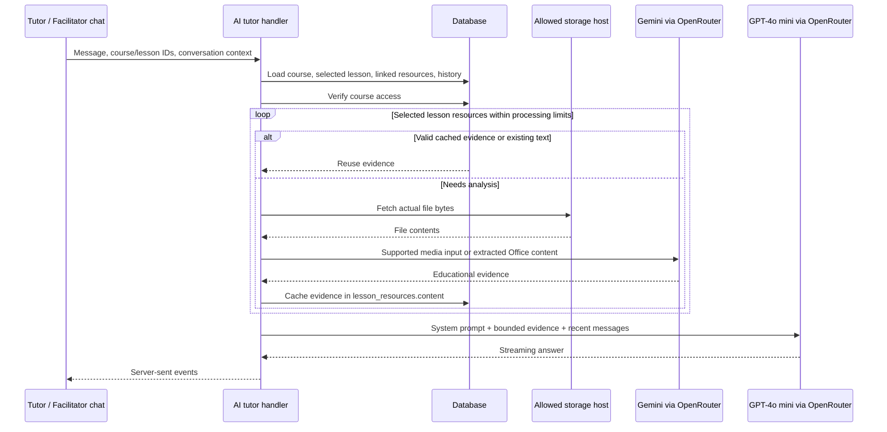

# AI course resource analysis: current implementation

Code review date: 29 October 2026. Repository: `skillpassport/`.

This document describes the code currently present in the local working tree. The resource-analysis changes are local modifications; their presence here does not establish that they have been deployed. This flow belongs to Skillpassport's AI tutor/facilitator, not LTE's theme feature.

## 1. What the system does

When a learner or educator sends a message from a course lesson, the server loads that lesson's context and linked resources from the database. It reuses available evidence or downloads supported files and asks Gemini to extract educational evidence. GPT-4o mini then uses the resulting text, lesson content, and conversation history to answer or generate material.

The two models have separate jobs:

| Job | Current model | Input | Output |
| --- | --- | --- | --- |
| Resource analysis | `google/gemini-3.1-flash-lite` through OpenRouter | PDF, video, images, audio, extracted Office content, or text | Markdown educational evidence |
| Conversation and teaching-material generation | `AI_MODELS.GPT_4O_MINI` | Role/persona instructions, lesson context, resource evidence, recent chat | Streamed reply, worksheet, or lesson plan |

There is no Qwen analysis route or automatic analysis-model fallback in these changes. Resource analysis is a non-streaming model request. The final chat response streams separately.

## 2. End-to-end flow



Assignment-review requests skip the new resource-analysis enrichment. They use the existing assignment flow rather than spending analysis calls on files.

## 3. Where it is coded

Paths below are relative to this document, so they can be opened directly.

| File | Responsibility |
| --- | --- |
| [ai-tutor-chat.ts](../functions/api/ai-tutor/handlers/ai-tutor-chat.ts) | Builds context, invokes resource enrichment before prompt generation, retains conversation history, selects GPT-4o mini, streams replies and persists messages |
| [course-context.ts](../functions/api/ai-tutor/utils/course-context.ts) | Reads course/lesson/resource/progress/video-summary records; formats the bounded context for the model |
| [course-resource-analysis.ts](../functions/api/ai-tutor/utils/course-resource-analysis.ts) | Checks access, reuses content/cache, applies the per-turn budget, calls analysis, writes cached evidence, attaches processing notes |
| [resource-analysis.ts](../functions/api/ai-tutor/utils/resource-analysis.ts) | Validates URLs and formats, downloads bounded file bytes, extracts Office content, calls Gemini, validates output, serializes/reads cache |
| [extract-content.ts](../functions/api/storage/handlers/extract-content.ts) | Authenticated explicit processing endpoint accepting resource IDs or a lesson ID |
| [storage route](../functions/api/storage/[[path]].ts) | Routes `/api/storage/extract-content` through the storage API's authentication layer |
| [ai-config.ts](../functions/api/shared/ai-config.ts) | Shared conversation model and endpoint configuration |
| [teaching-conversation.ts](../functions/api/ai-tutor/utils/teaching-conversation.ts) | Existing educator persona and teaching-intent routing used by the chat handler |
| [useTutorChat.ts](../src/features/ai-tutor/model/useTutorChat.ts) | Client conversation, request, loading, streaming, and history state |
| [AITutorPanel.tsx](../src/features/ai-tutor/ui/AITutorPanel.tsx) | Tutor/facilitator chat interface |
| [types.ts](../functions/lib/types.ts) | Environment types, including optional `AI_RESOURCE_ALLOWED_HOSTS` |

## 4. How URLs become actual content

The model is not merely told to visit a link. The backend fetches the file and sends its actual bytes, or extracted content, to OpenRouter.

Resource records come from `lesson_resources`, filtered by the selected lesson. Their fields include `resource_id`, `name`, `type`, `url`, and `content`.

The file type is resolved from the URL pathname extension, then the resource filename, then the resource type. This is extension-based routing, not a comprehensive file-signature validation service.

URL checks require:

- HTTPS.
- No embedded username or password.
- No custom port other than 443.
- An exact hostname present in the configured allowlist.
- No HTTP redirects; the download uses `redirect: 'error'`.

Allowed hostnames come from `CLOUDFLARE_R2_PUBLIC_URL`, `SUPABASE_URL`, and comma-separated entries in `AI_RESOURCE_ALLOWED_HOSTS`. Adding a host does not make a private file accessible: the download must still succeed with the URL provided. There is no Google Drive login, folder crawler, or browser session attached to the fetch.

Consequently, a folder link, YouTube page, or private document webpage is not equivalent to an accessible supported media-file URL. Arbitrary URLs pasted into chat are not automatically added as course resources.

## 5. File handling by format

| Format | Current processing | Practical limitation |
| --- | --- | --- |
| PDF | Downloads bytes and sends a base64 PDF `file` part, using OpenRouter's `file-parser` plugin with `pdf.engine: native` | Coverage depends on the model and document quality; scanned/complex documents need representative validation |
| PPTX | Unzips selected Office XML and embedded images, then sends text/image parts | Does not render slides or preserve full visual layout |
| DOCX | Unzips selected document XML and embedded images, then sends text/image parts | Does not render Word pages or establish original page numbering |
| MP4, WebM, MOV | Sends downloaded bytes as a base64 `video_url` part | A size limit is enforced; there is no long-video segmentation pipeline |
| MP3, WAV, OGG | Sends base64 bytes as `input_audio` | No separate durable transcription job is created by this flow |
| PNG, JPG/JPEG, WebP | Sends base64 bytes as `image_url` | Output is model-generated analysis |
| TXT, Markdown, CSV | Decodes file bytes as text and sends a text part | No spreadsheet workbook parsing is included |
| Legacy PPT, DOC | Rejects with a conversion message | Must first be converted to PDF, PPTX, or DOCX |
| Other extensions | Rejects as unsupported | No general file-conversion fallback |

### Office extraction details

`officeParts()` uses `fflate` to read the ZIP-based Office container. It includes:

- Word document body, footnotes, endnotes, numbered headers and footers.
- PowerPoint slide XML and speaker-note XML.
- Chart XML from Word/PowerPoint.
- Embedded PNG, JPEG, and WebP images.

XML tags are stripped and common entities decoded. This preserves text values, including text inside tables, but it does not retain a structured table grid, chart semantics, fonts, positions, or animations. XML source-section names accompany the text. Images are explicitly labeled as having no established slide/page association.

The extractor bounds archive expansion at 32 MB and extracted XML text at 200,000 characters. More than 12 supported embedded images causes a conversion-to-PDF error rather than silently claiming full visual coverage.

## 6. What Gemini is asked to return

The analysis prompt requests faithful educational evidence: definitions, procedures, examples, formulas, tables, learning objectives, and important visual information. It asks for page numbers, slide section identifiers, or video timestamps only when observable.

It explicitly treats the resource as untrusted data, forbids following instructions found inside it, and asks the model to report unreadable sections and coverage limitations. These instructions reduce risk; they do not make extraction perfectly accurate.

The request uses:

| Setting | Value |
| --- | --- |
| Endpoint | `https://openrouter.ai/api/v1/chat/completions` |
| Model | `google/gemini-3.1-flash-lite` |
| Streaming | `false` |
| Temperature | `0.1` |
| Maximum output | `5000` tokens |
| Request timeout | 60 seconds, combined with any caller abort signal |

The result must contain nonempty string content and `finish_reason: stop`. Empty, malformed, or length-truncated responses are rejected and are not cached as completed analysis. A normal stop still does not independently prove every page/frame was covered.

## 7. Database content and cache reuse

No new database table or migration is required for this implementation. It reuses `lesson_resources.content`.

New analysis is stored in this format:

```text
[COURSE_RESOURCE_ANALYSIS_V1]
{"model":"google/gemini-3.1-flash-lite","url":"https://allowed-host/lesson.pdf","analyzedAt":"ISO timestamp","text":"Markdown evidence"}
```

`cachedAnalysis()` reuses it only when the prefix is recognized, the model matches, the source URL matches, the text is a string, and its age is between zero and 24 hours. Invalid or expired cache entries are rebuilt on a later request.

Existing non-placeholder plain text in `content` is preserved and reused without a model call. It does not receive the new cache's 24-hour expiry. The known old PDF placeholder is eligible for replacement.

After analysis, the update is constrained by both resource ID and source URL. If saving fails, the evidence is still usable for the current reply and a cache-write warning is attached. A later turn may therefore pay for analysis again.

This cache is shared at the resource-record level, not stored per conversation. It has no content hash, background refresh, processing lock, or concurrent-request deduplication. Replacing a file behind the same URL can leave stale cached evidence for up to 24 hours; use a new URL when replacing a source.

## 8. Access checks

`canAnalyzeCourseResources()` first checks for a `course_enrollments` record matching the user ID as `learner_id` and the requested course. If that fails and the caller is considered an educator, it checks that the course exists with `status: Active`.

This educator fallback is an active-course check, not an educator ownership or institution-membership check. That is the scope of this helper; it should not be described as a complete tenant-authorization audit.

When enrichment cannot verify access, it clears the resource content from that context and returns false. The normal chat handler returns HTTP 403 for that failure. Resource processing relies on authenticated API context; no arbitrary caller-supplied file URL is accepted by the extraction endpoint.

## 9. Context loaded versus context actually sent

`buildCourseContext()` reads:

- Course title, description, and code.
- Course modules and lessons to resolve structure and the current lesson.
- Selected lesson content and its linked resources.
- Learner course progress.
- An existing completed `video_summaries` record, including key points and transcript.

Loading records does not mean every field is sent to the model. `formatCourseContextForPrompt()` focuses on the current lesson:

| Evidence | Current prompt budget |
| --- | --- |
| Course title | Included |
| Current lesson title and module title | Included when a valid selected lesson exists |
| Current lesson content | Up to 30,000 characters |
| Existing video key points | Included when present |
| Resource evidence | Up to 20,000 characters per resource, within 60,000 resource characters total |
| Existing video transcript | Up to 30,000 characters |
| Course description when no current lesson exists | Up to 10,000 characters |

The resource wrapper includes resource ID/name and processing notes. The model is told to cite resource names and supplied source locations, state missing coverage, and avoid invented citations. Text truncation is labeled. These are character limits, not a token-based retrieval budget.

The full module/lesson structure and learner-progress records are not automatically all serialized by this formatter. With a selected lesson, its content is emphasized rather than always appending the course description. With no selected lesson, this flow does not fetch/analyze resources from every lesson.

## 10. Conversation and persona integration

The chat handler builds the role-based prompt for learners or educators and uses the existing teaching-conversation router for educator behavior. Resource analysis supplies evidence to that conversation; it does not select a new persona or create another chat session.

The handler retains the latest 12 messages and also retains the latest message carrying worksheet or lesson-plan configuration if it has fallen outside that window. This supports follow-up discussion and revisions without replaying the entire history on every request.

GPT-4o mini receives the resulting prompt and text evidence. It is not receiving the original PDF/video bytes in the final chat call; Gemini receives those during the earlier analysis stage.

Existing worksheet/lesson-plan generation branches consume the enriched course context. Assignment publication remains an application action. The model is explicitly told not to simulate publishing or claim that chat text has assigned work. This resource feature does not implement learner submissions, grading, or results dashboards.

## 11. Limits, loading, and error behavior

For automatic enrichment during a normal chat turn:

- Each downloaded resource is limited to 20 MB, checked using both declared content length and streamed bytes.
- At most three fresh analysis attempts are made per turn. Failed attempts consume that turn's attempt count.
- A shared 45-second deadline covers the enrichment loop. The model helper's 60-second timeout does not extend this chat budget.
- Cached evidence and existing usable text do not consume fresh-analysis attempts.
- Resources are processed sequentially. Remaining resources receive a budget/coverage note and can be revisited on later turns.

The client has request/loading/streaming state, but this change does not add individual file-progress events. Analysis completes or reaches its limits before the handler creates the SSE response. The user may therefore wait before any answer text appears; there is no new percentage indicator or per-file processing timeline.

A failed resource normally produces an `analysisError` note and the conversation continues with available lesson/evidence. Examples include disallowed host, inaccessible download, unsupported extension, size/Office limits, timeout, provider error, incomplete output, and cache-write failure. A disconnected caller aborts processing rather than completing the reply normally.

There is no automatic retry queue or analysis-model fallback. Evidence cannot be assumed complete simply because the chat succeeded.

## 12. Explicit extraction API

`POST /api/storage/extract-content` accepts one of:

```json
{ "resourceId": "resource-uuid" }
```

```json
{ "resourceIds": ["resource-uuid-1", "resource-uuid-2"] }
```

```json
{ "lessonId": "lesson-uuid" }
```

IDs must be UUIDs. A list accepts at most three IDs. The lesson form is rejected when the lookup returns more than three resources; callers should then submit explicit batches.

The server resolves resource -> lesson -> module -> course, verifies access, rebuilds the lesson context, narrows it to the requested resource, and invokes the same enrichment helper. Each resource invocation gets its own enrichment deadline in this endpoint; the normal chat's single shared deadline should not be mistaken for a request-wide limit here.

The response contains `processed` and per-resource results with `resourceId`, `name`, `status`, `contentLength`, and an optional error. An HTTP 200 envelope can contain resource-level failures, so callers must inspect the individual statuses. The endpoint does not return the full evidence body in these result objects.

## 13. Configuration and dependencies

| Configuration | Purpose |
| --- | --- |
| `OPENROUTER_API_KEY` | Server-side credential for analysis requests |
| `CLOUDFLARE_R2_PUBLIC_URL` | Supplies an allowed resource hostname |
| `SUPABASE_URL` | Supplies an allowed resource hostname and existing backend configuration |
| `AI_RESOURCE_ALLOWED_HOSTS` | Optional comma-separated extra exact hostnames |

The model ID is defined centrally as `AI_MODELS.GEMINI_3_1_FLASH_LITE` in `functions/api/shared/ai-config.ts`. `resource-analysis.ts` references it through `RESOURCE_ANALYSIS_MODEL`, and uses `API_CONFIG.OPENROUTER.endpoint` for requests. Change the shared model constant to update analysis requests and cache-model matching together. There is no user-facing model picker. `fflate` is an explicit dependency used for Office ZIP extraction. Credentials remain server-side and are not included in the chat prompt or this document.

## 14. Tests and validation scope

Relevant automated tests:

- [resource-analysis.test.ts](../functions/api/ai-tutor/utils/__tests__/resource-analysis.test.ts): PDF request shape/cache reuse, PPTX notes/images, DOCX text/table values, video media input, invalid hosts/legacy formats/size limits, incomplete model output.
- [course-resource-analysis.test.ts](../functions/api/ai-tutor/utils/__tests__/course-resource-analysis.test.ts): access/enrichment/cache behavior.
- [extract-content.test.ts](../functions/api/storage/handlers/__tests__/extract-content.test.ts): authenticated ID-based extraction behavior.
- Existing tutor chat, context, and storage authentication tests provide additional integration coverage.

The initial implementation was validated with 53 focused tests, targeted TypeScript checking, and Pages Functions compilation. Synthetic live OpenRouter smoke tests recovered expected facts from PDF, PPTX, DOCX, and a short rendered WebM. These results demonstrate the exercised request compatibility, not comprehensive production-document accuracy or a model-quality benchmark. Those checks were performed during implementation, not rerun merely to write this document.

The opt-in paid smoke-test script is [test-resource-analysis.mjs](../scripts/test-resource-analysis.mjs). From `skillpassport/`:

```powershell
npm run test:resource-analysis:live
npm run test:resource-analysis:live -- --video
```

It uses synthetic fixtures and the configured OpenRouter key. The video option needs Chrome/Chromium; `CHROME_PATH` can specify the browser executable.

## 15. Implemented scope and remaining work

Implemented locally: supported resource downloading, native PDF/video/media model inputs, bounded Office extraction, Gemini evidence generation, resource-level cache reuse, selected-lesson prompt enrichment, authenticated ID-based explicit processing, failure notes, and focused/synthetic validation.

Not implemented by this resource-analysis change:

- Full-course ingestion, vector indexing, embeddings, or question-specific retrieval across every lesson.
- Recursive folder/link crawling, authenticated Google Drive access, or general website browsing.
- Legacy Office conversion and faithful Office page/slide rendering.
- Long-video chunking, a durable transcription pipeline, or unlimited media processing.
- Durable background jobs, retry scheduling, concurrency locks, and content-hash cache invalidation.
- A verified clickable citation viewer linking each statement to a page/frame.
- Per-resource progress streaming in the chat UI.
- Production-quality benchmarking across representative course files, languages, scans, diagrams, and long lectures.
- New submission, automated grading, or educator-results workflows.

For example, if the selected lesson has one PDF, one PPTX, and one small MP4 on allowed storage, a first chat turn can attempt all three within the shared time budget, cache successful evidence, and use it for the reply. A later turn reuses that evidence. If the lesson instead contains six uncached resources, only the first three fresh attempts are allowed on that turn, and evidence may be incomplete because of the time and prompt budgets. The implementation must be understood as bounded current-lesson analysis, not guaranteed exhaustive course understanding.
